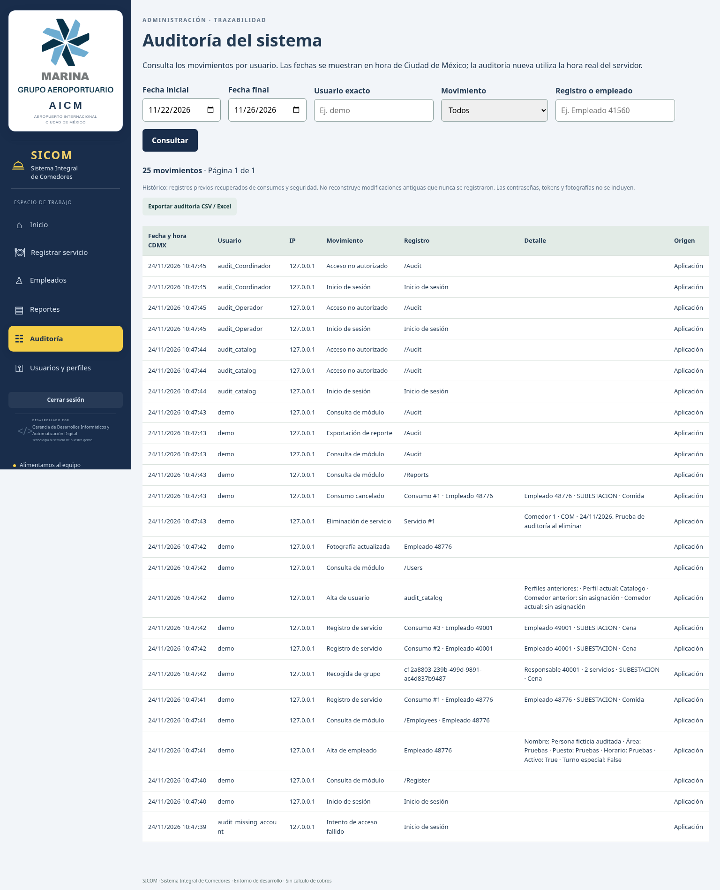

# Auditoría, firma lateral y terminal de CREI — 24/11/2026

## Cambios visibles

El crédito del área desarrolladora se muestra debajo de **Cerrar sesión**, con símbolo de código y tonos discretos de marca de agua. Se retira de la barra horizontal y del pie de páginas autenticadas; en el acceso sin sesión se conserva la firma del pie.

El menú **Auditoría** está disponible únicamente para el perfil **Administrador**. El servidor protege también la URL y la exportación CSV; ocultar el enlace no es la única restricción. El reporte permite fechas, usuario exacto, movimiento y búsqueda por registro o empleado, con 100 filas por página y exportación de hasta 50 000 movimientos por consulta. El periodo máximo es de 366 días de diferencia entre fechas.

## Qué queda registrado

La nueva tabla `AuditLogs` guarda fecha/hora UTC, usuario, IP vista por la aplicación, movimiento, registro afectado, detalle, origen y clave de origen cuando corresponde. En pantalla se utiliza Ciudad de México; los eventos nuevos usan la hora real, aunque el servicio esté probándose con fecha simulada.

Se registran accesos correctos, fallidos y rechazados por terminal, intentos de consulta sin permiso, cierre de sesión, consultas de módulos y empleados, exportaciones, altas/modificaciones/bajas de empleados, fotografías actualizadas, servicios individuales, recogidas y sus consumos, cancelaciones, altas de usuarios, cambios de perfil/comedor y eventos administrativos de seguridad. Las modificaciones de empleados muestran campos y valores anteriores/nuevos. Perfiles y comedores indican su asignación anterior y actual. Una cancelación puede tener un movimiento de consumo y otro de seguridad con su motivo: son dos aspectos de la misma operación, no dos consumos eliminados.

Los cambios de datos rastreados mediante `AppDb.SaveChangesAsync` se guardan en la misma transacción que su auditoría. Si se revierte la transacción, se revierten ambos. Los reenvíos idempotentes de servicios no crean otro movimiento de alta. Las fotos se guardan primero en el sistema de archivos y después se registra su actualización; no existe una transacción distribuida entre disco y PostgreSQL.

Las consultas de reloj, contador, fotos y archivos estáticos no generan un evento por cada actualización automática. La consulta de la propia auditoría sí se registra al terminar de atenderla, por lo que aparece en la consulta siguiente.

No se copian contraseñas, hashes, tokens de restablecimiento, cookies, cuerpos completos de solicitudes ni contenido de fotografías. Los detalles de empleados y motivos administrativos sí son datos del sistema y deben tratarse como información interna.

## Historial anterior

Al iniciar se crea la tabla si falta y se incorporan los consumos y eventos de seguridad existentes, con claves únicas para no duplicarlos. Aparecen como **Histórico**, con autor/fecha/IP disponibles en el registro original; los eventos de seguridad antiguos pueden no tener IP. Fechas simuladas de consumos de pruebas se conservan como estaban. No se inventan altas, modificaciones ni consultas anteriores que nunca se registraron.

La auditoría no tiene botones de edición o eliminación. No es un almacenamiento externo inmutable: un administrador de PostgreSQL con permisos suficientes puede modificar las tablas. Los cambios hechos por SQL, herramientas externas o importadores no se auditan automáticamente mediante la aplicación. Deben documentarse por separado o utilizar un procedimiento explícito como el ajuste de CREI incluido aquí. La restauración de respaldos puede retroceder también el historial; conservar los respaldos y controles operativos habituales.

## CREI: alcance confirmado

El usuario confirmó **sólo ajustar la IP de CREI y mantener los demás comedores**.

- CREI conserva su identificador, horarios, cuentas y consumos.
- Su terminal autorizada será `172.16.70.68`.
- Se retiran únicamente otras IP asociadas a CREI, si existen.
- SUBESTACION, PLATAFORMA y sus terminales se conservan.
- Una instalación de desarrollo nueva ya siembra CREI sólo con esa IP. En bases existentes el cambio se realiza **explícitamente**, no durante el arranque.

El procedimiento es `scripts/sql/ajustar-crei-ip.sql`. Tiene transacción, bloqueo de configuración, validación de un único CREI y rechazo si `172.16.70.68` pertenece a otro comedor. Repetirlo cuando la configuración ya coincide no hace cambios ni duplica auditoría. El movimiento registra al usuario real de PostgreSQL como `DB:nombre`; no inventa una sesión administrativa de la aplicación.

## Integración local antes del servidor

Pedir a Codex local integrar la versión de este cambio, con respaldo del código y conservando scripts de inicio, conexiones, fotos, `.local` y la base `comedores_pruebas`. `Program.cs` requiere integrar el registro de `IHttpContextAccessor`, política de Auditoría, inicialización de `AuditLogs`, auditoría de consultas y nueva ruta protegida, conservando sus ajustes de `ForwardedHeaders` y cualquier otra configuración local. Las plantillas, modelos, `Data.cs`, `AuditLog.cs` y CSS deben corresponder a la misma versión.

Compilar e iniciar primero con la copia independiente de pruebas. Al arrancar crea `AuditLogs` e incorpora el historial disponible. Verificar auditoría como administrador y ausencia de acceso con los otros perfiles.

El SQL de CREI se aplica primero a esa copia **con respaldo previo**. Comando de referencia para el equipo local, que se dará como un paso separado después de verificar la base y el respaldo:

```powershell
& 'C:\Program Files\PostgreSQL\17\bin\psql.exe' -h 127.0.0.1 -p 5432 -U comedores_dev -d comedores_pruebas -W -v ON_ERROR_STOP=1 -f .\scripts\sql\ajustar-crei-ip.sql
```

No apunta al servidor de producción. Para pruebas operativas de CREI utilizar `-Comedor CREI` con el script local y la fecha de prueba elegida, después de comprobar el mapa de terminales.

## Aplicación posterior en 172.16.2.12

**No se ha aplicado este cambio al servidor.** Se conserva el acuerdo de ir paso a paso: verificar estado, respaldar, publicar el código, validar auditoría y después revisar/aplicar el SQL de CREI.

La producción conocida utiliza PostgreSQL **17 en 5433**, base `comedores`, aplicación en `/opt/comedores` y configuración privada en `/etc/comedores`. No copiar `comedores_pruebas` sobre producción. Verificar nuevamente estas rutas y el mapa de terminales antes de modificar nada.

Para que la auditoría y la identificación del comedor reciban la IP real detrás de Nginx, comprobar el manejo de `ForwardedHeaders` de la copia de publicación, confiando sólo en loopback y `ForwardLimit=1`, como indica la guía de publicación. No confiar cabeceras arbitrarias de clientes externos.

El script SQL requiere que `AuditLogs` ya exista. La aplicación y su auditoría deben publicarse antes del ajuste de CREI. Anotar las IP anteriores y conservar el respaldo. Si hubiera que revertir únicamente el mapa de terminales, preparar una transacción inversa con esos valores; no restaurar toda la base, pues eliminaría movimientos posteriores.

## Validación realizada en el entorno de desarrollo

- Compilación sin errores ni advertencias.
- 123 comprobaciones en PostgreSQL temporal: historial sin duplicados, autor/IP y antes/después, rollback de datos y auditoría, escritura fallida sin evento falso, CSV con fórmulas neutralizadas y paginación.
- Navegador: acceso de administrador y rechazo para Operador/Coordinador/Catálogo, accesos, empleados, servicios, grupos, usuarios, fotos, eliminación, idempotencia, filtros/CSV, ausencia de contraseñas y cuatro tamaños de pantalla.
- SQL en otra base temporal: conserva otros comedores y terminales, deja CREI con `172.16.70.68`, registra el cambio, no duplica al repetirlo y revierte sin cambios si la IP pertenece a otro comedor.

Las capturas usan sólo datos ficticios.


