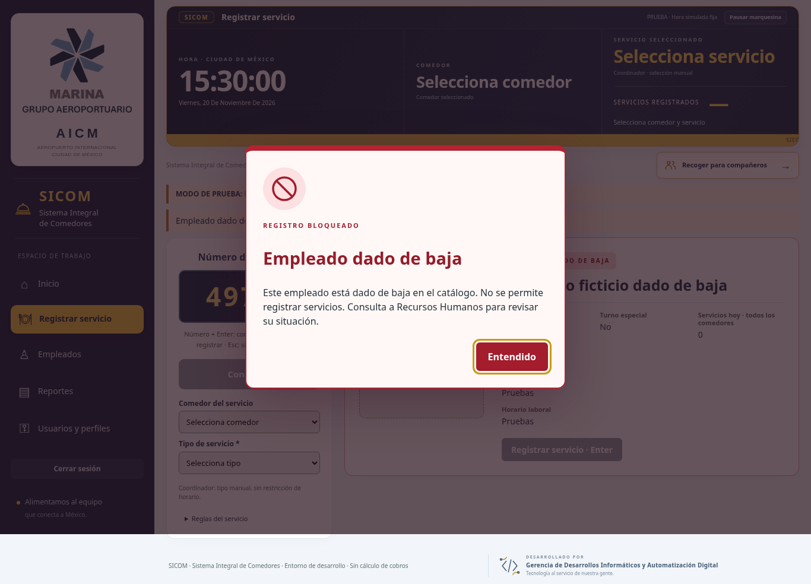

# Aviso de empleado dado de baja

En **Registrar servicio**, una consulta de un empleado cuyo estado no es activo abre un diálogo específico:

- Título **Empleado dado de baja**.
- Borde y botón rojos, fondo claro y símbolo de prohibición.
- Leyenda **REGISTRO BLOQUEADO** y explicación de que debe revisarse con Recursos Humanos.
- El botón de registrar permanece deshabilitado. Al cerrar, el número queda enfocado y seleccionado.

La ficha del empleado conserva una etiqueta visible **EMPLEADO DADO DE BAJA**, incluso después de cerrar el aviso. Una consulta posterior de un empleado activo recupera el estado normal. Funciona tanto al consultar sin recargar la página como al abrir una URL con `?Number=...`.

En **Recoger para compañeros**, se utiliza el mismo diseño al consultar un responsable o compañero dado de baja. No se agrega a la recogida y se conservan los integrantes existentes. Los avisos de empleado no encontrado, servicios repetidos y éxito mantienen su propio diseño.

No cambia la regla del servidor: una solicitud directa de registro para un empleado dado de baja también se rechaza. No se modifican estados de empleados, registros históricos, permisos, conexiones ni scripts de inicio.

## Integración local

Integra el commit de este cambio desde la rama `desarrollo/primera-version-web` de https://github.com/hmunoz-gdi/comedoresWEB, respaldando los archivos afectados y conservando configuración y datos privados. Las dos plantillas Razor, `quick-registration.js`, `pickup.js` y `site.css` deben actualizarse juntas. Compila, reinicia la aplicación y recarga con **Ctrl+F5**.

## Validación

Compilación sin errores ni advertencias. `tests/browser/inactive-employee.cjs` usa exclusivamente un empleado ficticio en la base aislada `comedores_pickup_test`: verifica consulta AJAX y URL directa, deshabilitación y rechazo de POST, retorno del foco y selección, recuperación con empleado activo, baja de responsable y compañero, conservación del grupo, diferencias de color y restablecimiento del estilo para otros avisos, y tres tamaños de pantalla.

