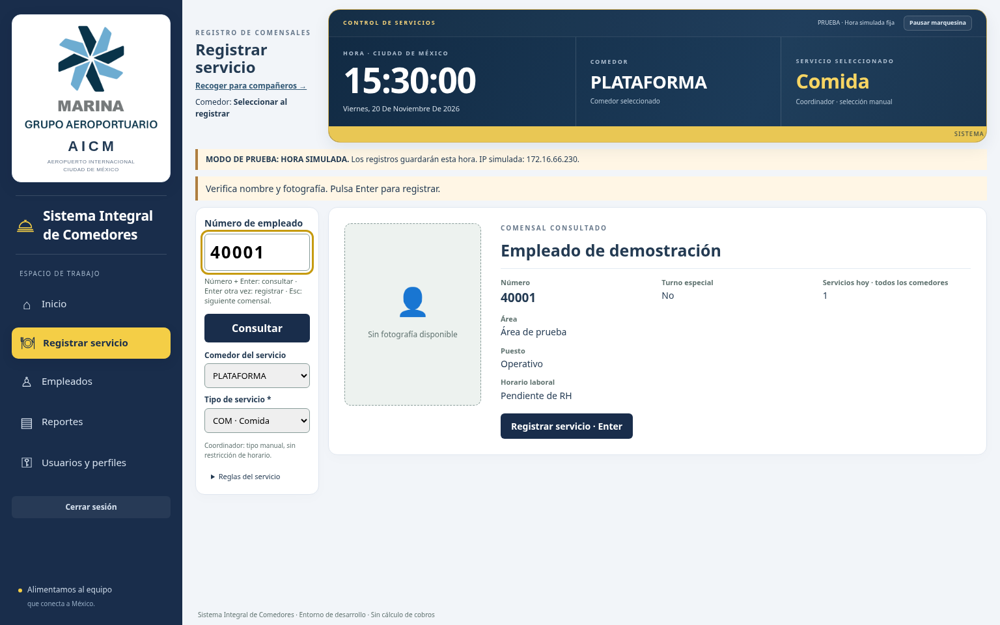

# Hora, comedor y servicio con mayor visibilidad

El menú lateral utiliza el logo existente de Marina Grupo Aeroportuario, con AICM debajo. Se elimina el logo de la barra horizontal para dar espacio a tres bloques: hora del servidor y fecha de Ciudad de México, comedor y servicio. Se conservan los estados en línea/sin conexión/prueba y el botón para pausar únicamente la marquesina; el reloj continúa funcionando.

Para un operador, el comedor sigue siendo el que identifica la IP y el servicio sigue determinado por los horarios. Para un coordinador, la barra muestra **Selecciona comedor** y **Selecciona servicio** hasta elegirlos. Cambia al instante con los combos y conserva sus valores visibles después de consultar o registrar al siguiente comensal. No selecciona automáticamente un comedor distinto ni modifica restricciones de acceso.

En Inicio se muestra **Sistema Integral de Comedores** sobre la imagen gastronómica. Como propuesta de nombre corto: **SICOM AICM**, por Sistema Integral de Comedores. El nombre corto todavía no se aplica como marca definitiva.

## Incorporar a la copia de trabajo

Detener la aplicación local con Ctrl+C y respaldar los archivos anteriores. Incorporar únicamente:

- `src/Comedores.Web/Pages/Index.cshtml`
- `src/Comedores.Web/Pages/Register.cshtml`
- `src/Comedores.Web/Pages/Shared/_Layout.cshtml`
- `src/Comedores.Web/wwwroot/css/site.css`
- `src/Comedores.Web/wwwroot/js/server-clock.js`
- `src/Comedores.Web/wwwroot/js/quick-registration.js`

El logo `wwwroot/images/grupo-aeroportuario-marina.png` ya forma parte del proyecto. Se mantienen las imágenes gastronómicas de la actualización anterior. No sustituir todo `src`, ni Program.cs, scripts de inicio, configuración privada o datos.

Compilar e iniciar con el comando habitual de la base local de pruebas. Actualizar el navegador con Ctrl+F5. Este cambio no se aplica al servidor hasta publicar y desplegar. No requiere cambios de base de datos.

Prueba visual y funcional: `tests/browser/operational-banner.cjs`, exclusivamente con una base aislada. Comprueba selección manual, consulta y guardado con conservación de selección, operador con IP simulada, reloj fijo de prueba, identidad lateral, ausencia de logo en la barra y seis tamaños de pantalla sin desbordamiento. La suite existente `tests/browser/server-clock.cjs` verifica reloj real independiente del cliente, cambios de horario y fecha, desconexión, recuperación, pausa y simulación.
