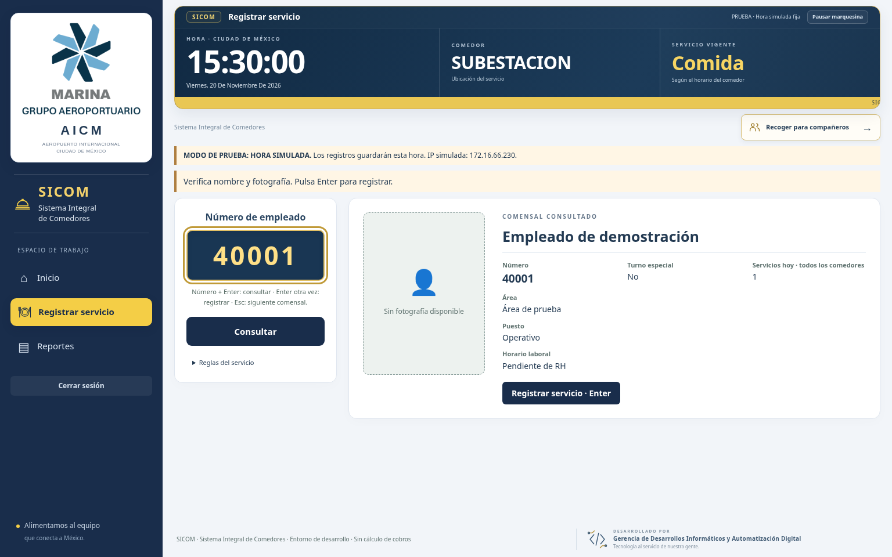
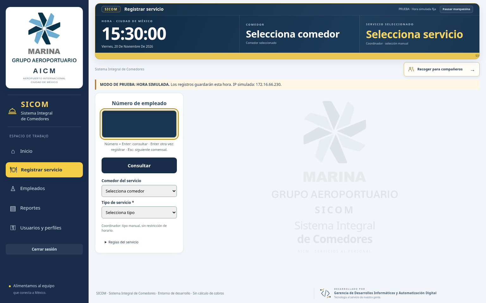

# Hora, comedor y servicio con mayor visibilidad

El menú lateral utiliza el logo existente de Marina Grupo Aeroportuario, con AICM debajo. Se elimina el logo de la barra horizontal para dar espacio a tres bloques: hora del servidor y fecha de Ciudad de México, comedor y servicio. Se conservan los estados en línea/sin conexión/prueba y el botón para pausar únicamente la marquesina; el reloj continúa funcionando.

Para un operador, el comedor sigue siendo el que identifica la IP y el servicio sigue determinado por los horarios. Para un coordinador, la barra muestra **Selecciona comedor** y **Selecciona servicio** hasta elegirlos. Cambia al instante con los combos y conserva sus valores visibles después de consultar o registrar al siguiente comensal. No selecciona automáticamente un comedor distinto ni modifica restricciones de acceso.

En Inicio se muestra **Sistema Integral de Comedores** sobre la imagen gastronómica. **SICOM**, por Sistema Integral de Comedores, se incorpora en menú lateral, barra de registro, marca de agua, Inicio, acceso y título del navegador.

## Incorporar a la copia de trabajo

Detener la aplicación local con Ctrl+C y respaldar los archivos anteriores. Incorporar únicamente:

- `src/Comedores.Web/Pages/Index.cshtml`
- `src/Comedores.Web/Pages/Login.cshtml`
- `src/Comedores.Web/Pages/Register.cshtml`
- `src/Comedores.Web/Pages/Shared/_Layout.cshtml`
- `src/Comedores.Web/wwwroot/css/site.css`
- `src/Comedores.Web/wwwroot/js/server-clock.js`
- `src/Comedores.Web/wwwroot/js/quick-registration.js`

El logo `wwwroot/images/grupo-aeroportuario-marina.png` ya forma parte del proyecto. Se mantienen las imágenes gastronómicas de la actualización anterior. No sustituir todo `src`, ni Program.cs, scripts de inicio, configuración privada o datos.

Compilar e iniciar con el comando habitual de la base local de pruebas. Actualizar el navegador con Ctrl+F5. Este cambio no se aplica al servidor hasta publicar y desplegar. No requiere cambios de base de datos.

Prueba visual y funcional: `tests/browser/operational-banner.cjs`, exclusivamente con una base aislada. Comprueba selección manual, consulta y guardado con conservación de selección, operador con IP simulada, reloj fijo de prueba, identidad lateral, ausencia de logo en la barra y seis tamaños de pantalla sin desbordamiento. La suite existente `tests/browser/server-clock.cjs` verifica reloj real independiente del cliente, cambios de horario y fecha, desconexión, recuperación, pausa y simulación.

## Captura ampliada y marca de agua

La barra ocupa todo el ancho del contenido principal y aparece directamente arriba, sin encabezado externo. Dentro de ella se muestra **SICOM · Registrar servicio** en lugar de Control de servicios. La altura y el espaciado se redujeron conservando la legibilidad. El botón **Recoger para compañeros** aparece debajo de la barra, separado de Consultar y Registrar para distinguir el flujo individual del de encargos.

El número de empleado tiene cifras de 38 a 46 píxeles y un campo de 70 a 88 píxeles de alto según el tamaño de pantalla. El área de captura es más ancha. Cuando no se está consultando un empleado, una marca de agua grande muestra el logo de Grupo Aeroportuario y el nombre del sistema; se oculta al mostrar la ficha y reaparece después de limpiar, registrar o no encontrar un empleado. Es decorativa, no recibe clics ni se anuncia al lector de pantalla.

La firma de autoría al pie utiliza un símbolo de código y circuitos, **Desarrollado por · Gerencia de Desarrollos Informáticos y Automatización Digital**, y **Tecnología al servicio de nuestra gente**. No se añadieron imágenes tecnológicas grandes sobre las fichas: la firma distingue el trabajo del equipo sin competir con la identidad institucional ni la operación.

Si la actualización anterior de barra ya está instalada, esta revisión requiere `Pages/Register.cshtml`, `Pages/Shared/_Layout.cshtml`, `Pages/Index.cshtml`, `Pages/Login.cshtml` y `wwwroot/css/site.css`. El paquete acumulado conserva además los archivos de Inicio y JavaScript de la actualización anterior. No reemplazar Program.cs, configuración local, contraseñas o la base de datos.

Comprobado con consulta y guardado de un servicio ficticio: marca visible en vacío, oculta con ficha, visible después del éxito; conservación de combos, captura ampliada y barra completa. Revisión en seis tamaños de pantalla y compilación sin errores ni advertencias.

El campo de empleado tiene el número y su etiqueta centrados, fondo azul oscuro y cifras doradas de alto contraste. Cambia únicamente la presentación: conserva patrón numérico, límite de cinco dígitos, foco, teclado y validaciones existentes.
