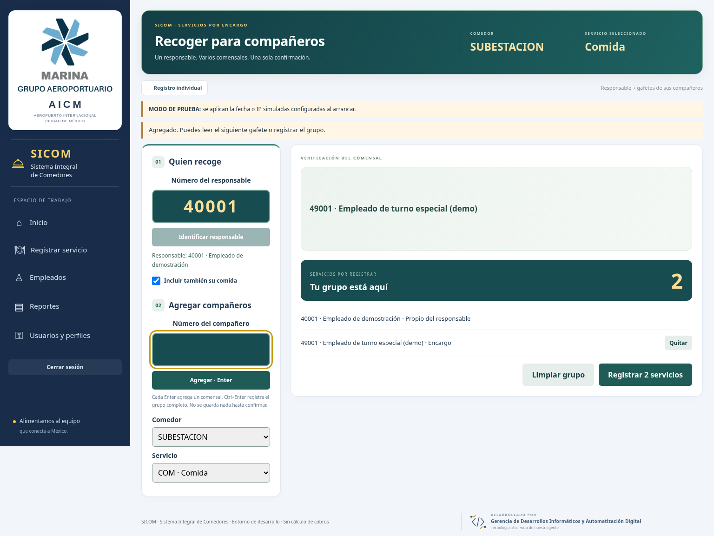
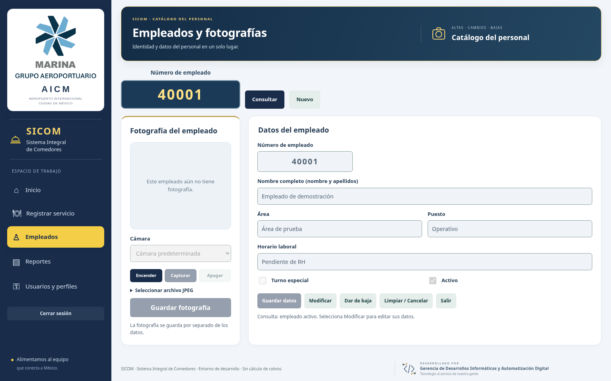

# Captura uniforme y diseño de módulos SICOM

## Recoger para compañeros

La cabecera verde petróleo distingue los servicios por encargo del registro individual azul. Conserva la marca SICOM, el comedor y el servicio. En Coordinador, estos últimos reflejan inmediatamente los combos. Para Operador, se muestra el comedor de la terminal y el servicio al abrir, mientras el servidor conserva la validación definitiva de horario al guardar.

Los campos de responsable y compañero tienen el mismo ancho, cifras grandes y centradas, fondo verde petróleo y texto dorado. El contador y la lista permiten revisar el grupo antes de confirmar. Enter agrega y Ctrl+Enter registra como antes. Si no existe un responsable o compañero, aparece **Empleado no encontrado**; al aceptar o cerrar el diálogo se recupera el foco en el campo correspondiente y se selecciona su contenido para corregirlo. El grupo válido ya preparado se conserva y no se registra ningún consumo por consultar un número inexistente.

## Empleados y fotografías

La cabecera azul con cámara distingue la administración del catálogo. El buscador se alinea con el ancho del panel de fotografía y los dos paneles comienzan a la misma altura. La ficha utiliza espacios y campos alineados, manteniendo los estados de Alta, Modificar, Baja y cámara.

Consultar un número inexistente abre un diálogo y devuelve el foco con el número seleccionado. No inicia automáticamente un alta: se conserva el botón **Nuevo** como acción explícita. Para crear, el número consultado se copia antes de enfocar el campo de alta, quedando seleccionado.

## Selección al enfocar, en todos los módulos

El recurso global `wwwroot/js/text-inputs.js`, cargado desde `_Layout.cshtml`, selecciona el contenido al enfocar campos de texto, búsqueda, teléfono, correo, URL, contraseña y áreas de texto mediante ratón o teclado. En un campo que ya tiene el foco, un segundo clic permite colocar el cursor y corregir una parte. No cambia valores ni genera operaciones de guardado. Los números de empleado se centran en registro, encargos y catálogo. Los nombres, áreas y demás textos descriptivos conservan su alineación normal para facilitar la lectura.

Casillas, listas desplegables, fechas, archivos y controles deshabilitados conservan su comportamiento nativo; no se intenta aplicar selección de texto donde no corresponde.

## Actualización local

Detén la aplicación con Ctrl+C y respalda los archivos a sustituir. Copia únicamente estos ocho archivos del paquete, respetando su ubicación:

- `src/Comedores.Web/Pages/Pickup.cshtml`
- `src/Comedores.Web/Pages/Employees.cshtml`
- `src/Comedores.Web/Pages/Employees.cshtml.cs`
- `src/Comedores.Web/Pages/Shared/_Layout.cshtml`
- `src/Comedores.Web/wwwroot/css/site.css`
- `src/Comedores.Web/wwwroot/js/pickup.js`
- `src/Comedores.Web/wwwroot/js/employees.js`
- `src/Comedores.Web/wwwroot/js/text-inputs.js` (nuevo)

Compila e inicia con tu comando habitual apuntando a `comedores_pruebas`, luego actualiza el navegador con Ctrl+F5. El paquete no contiene scripts de inicio ni Program.cs y no requiere cambios de base de datos. Evita sustituir el proyecto completo: conserva tu conexión local, simulación de fechas y comedores y demás cambios propios. Publicar al servidor es un paso posterior.

## Verificaciones

`tests/browser/capture-experience.cjs` comprueba errores de búsqueda, retorno y selección del foco, conservación del grupo, registro por teclado y combos, alta explícita, edición parcial con segundo clic, alineación de catálogo y cinco tamaños sin desbordamiento. Las suites existentes de encargos y empleados verifican además confirmaciones de repetición, reintentos, reportes, estados ABC, concurrencia, webcam, guardado de fotografía, bajas y permisos. Todas se ejecutan con datos ficticios en un servidor y carpeta de fotos aislados.
