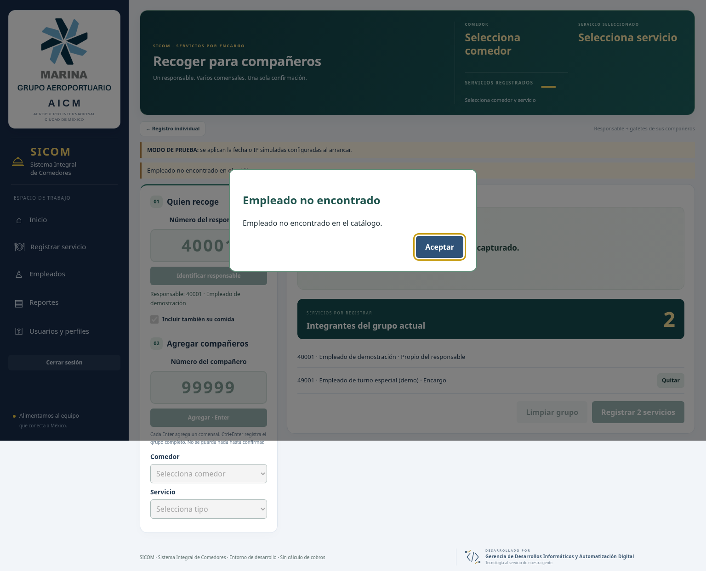
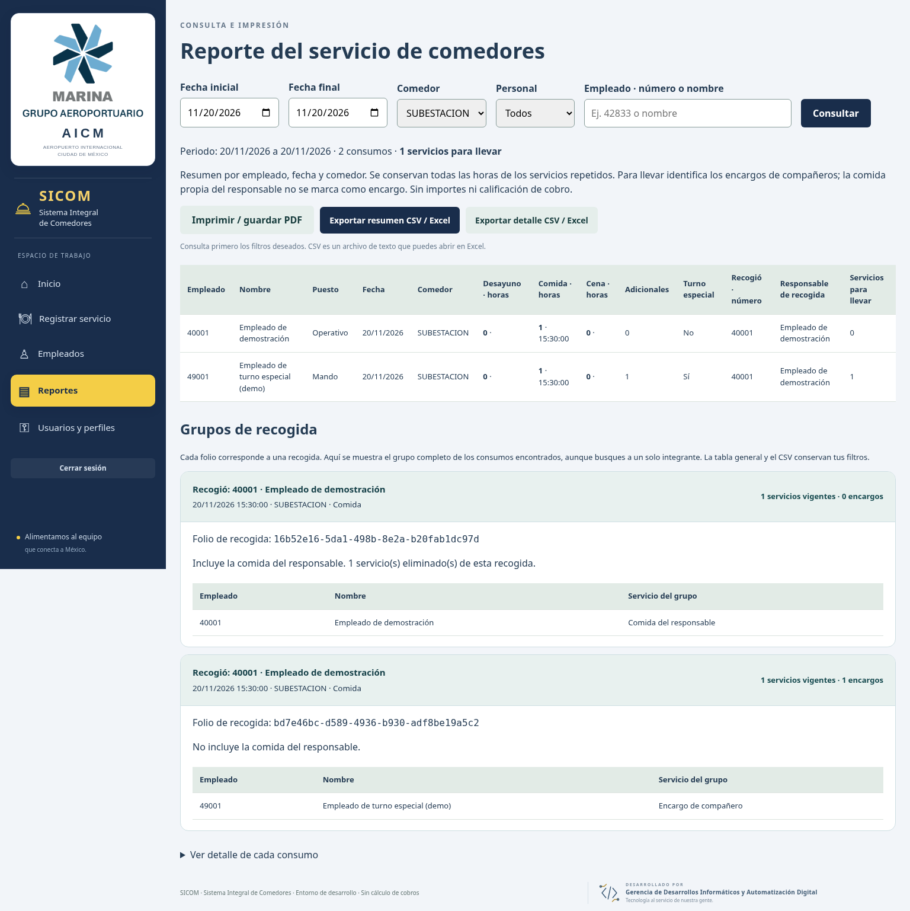

# Diálogos de consulta y grupos de recogida

## Empleado no encontrado

En **Recoger para compañeros**, consultar un número inexistente abre el diálogo **Empleado no encontrado**, tanto para el responsable como para sus compañeros. Al aceptar, vuelve al campo original con el número seleccionado. Conserva a los integrantes ya agregados y limpia la fotografía de la consulta fallida. También reconoce respuestas antiguas del servidor que contienen el mensaje pero no la bandera `notFound`.

Un empleado inactivo o un problema de conexión abre su propio aviso, sin confundirlo con un empleado inexistente. Los fallos de guardado conservan el mecanismo de reintento del grupo completo.

## Consultar quiénes integran una recogida

En **Reportes**, consulta las fechas y el comedor. Debajo del resumen aparece **Grupos de recogida**. Abre el encabezado de un grupo para ver:

- Número y nombre de quien recogió.
- Fecha, hora, comedor y servicio.
- Folio completo de la recogida.
- Todos sus integrantes, con número, nombre y distinción entre comida del responsable y encargo.
- Total vigente y cantidad de encargos; si se eliminaron servicios, indica cuántos.

Cada folio es un grupo distinto, incluso cuando la persona, hora y servicio coinciden. Si el responsable no pidió su propia comida, también se indica. La tabla de detalle tiene un enlace **Ver grupo** que abre la recogida exacta.

Si buscas un empleado, la tabla general y el CSV conservan ese filtro. La sección de grupos muestra los integrantes completos de las recogidas relacionadas con los resultados. Conserva el ámbito autorizado del comedor: no permite que un operador vea integrantes de otro comedor. Si todos los consumos de una recogida se eliminaron, ya no aparece entre los resultados vigentes.

Los CSV de detalle existentes ya incluyen el folio de recogida. No se agrega ningún registro ni se reconstruyen grupos por coincidencias de nombre u hora: se utiliza `PickupBatchId`, que identifica la operación real.

## Integración en el equipo local

Este cambio no necesita modificar `Program.cs`, `iniciar-windows.ps1`, conexiones ni esquema de base de datos. En Codex local pide integrar el commit correspondiente desde la rama `desarrollo/primera-version-web` de https://github.com/hmunoz-gdi/comedoresWEB.

Como hay copias locales con versiones anteriores de la pantalla, verifica que estos seis archivos queden completos y coherentes con la versión del commit, conservando ajustes locales ajenos al cambio:

```text
src/Comedores.Web/Pages/Pickup.cshtml
src/Comedores.Web/Pages/Reports.cshtml
src/Comedores.Web/Pages/Reports.cshtml.cs
src/Comedores.Web/wwwroot/js/pickup.js
src/Comedores.Web/wwwroot/js/report.js
src/Comedores.Web/wwwroot/css/site.css
```

Después compila, reinicia la aplicación y recarga con **Ctrl+F5**. La plantilla `Pickup.cshtml` debe contener `pickup-dialog` y cargar `pickup.js` con `asp-append-version="true"`.

## Validación

Compilación sin errores ni advertencias. Suite de 116 comprobaciones en PostgreSQL temporal. `tests/browser/pickup-groups.cjs` verifica diálogos en ambos campos, respuesta antigua sin bandera, conservación de integrantes y selección, varios grupos con el mismo responsable/hora/servicio, grupos completos al buscar un integrante, enlace al folio exacto, grupos sin comida propia, bajas parciales, aislamiento entre comedores y cuatro tamaños de pantalla. Se mantiene la prueba de contador, búsqueda, CSV y eliminación autorizada en `service-counter-reports.cjs`.

Las capturas de esta guía usan únicamente empleados ficticios.




