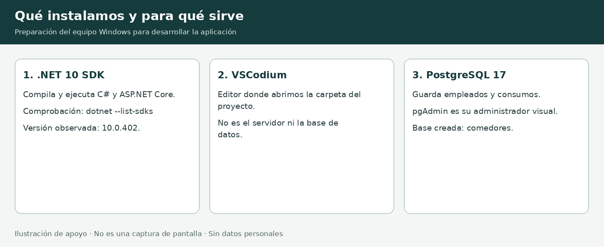
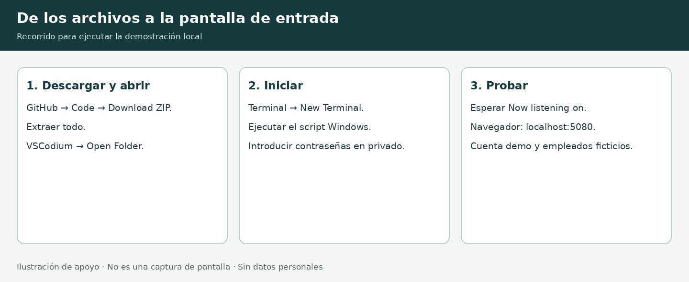

# Guía rápida para el equipo

Sistema Integral de Comedores · AICM · Primera versión de desarrollo

Dirigida al responsable del proyecto y sus dos compañeros. Corte documental: 21 de octubre de 2026. Las imágenes son ilustraciones de apoyo, no capturas de la aplicación ni evidencia de una instalación en otros equipos.

## 1. Qué estamos construyendo

Una aplicación web nueva en C# y ASP.NET Core, basada en los procesos y pantallas del sistema VB6. El primer incremento permite acceso, consulta de empleados ficticios, registro de consumos y reporte. Se ejecuta en el navegador; no requiere trasladar las pantallas VB6 literalmente.

Estado comprobado: el código compiló sin errores ni advertencias en el entorno de nube; pasaron 13 comprobaciones con PostgreSQL y una prueba HTTP de acceso, registro y filtros. En el equipo Windows mostrado se comprobó el SDK, se abrió VSCodium, se conectó pgAdmin, se creó la base y se abrió la carpeta del proyecto. Todavía no se ha confirmado el primer arranque de la aplicación en ese equipo.



## 2. Herramientas y comprobaciones

| Herramienta | Función | Evidencia o comprobación |
| --- | --- | --- |
| .NET SDK 10 | Compilar y ejecutar la aplicación | PowerShell: `dotnet --list-sdks`; debe aparecer `10.0.402` o un SDK 10 compatible |
| VSCodium | Editar y abrir el proyecto | Se ven `scripts`, `src`, `tests` y `global.json` en el explorador |
| PostgreSQL 17 | Guardar los datos | Servicio instalado; conexión disponible en pgAdmin |
| pgAdmin 4 | Administrar PostgreSQL visualmente | En Servers → PostgreSQL 17 → Databases aparece `comedores` |
| Navegador | Utilizar la aplicación | Acceso local después de iniciar el servidor |
| GitHub | Compartir y descargar el código | Rama `desarrollo/primera-version-web` |

Los dos compañeros deben verificar estos requisitos en sus propios equipos. Una instalación en un equipo no instala las herramientas en los demás.

Si se parte de cero: instalar el SDK desde https://dotnet.microsoft.com/download/dotnet/10.0, VSCodium desde https://vscodium.com/ y PostgreSQL desde https://www.postgresql.org/download/windows/. Elegir instaladores Windows x64 en equipos Intel/AMD de 64 bits. En PostgreSQL incluir servidor, pgAdmin y herramientas de línea de comandos; Stack Builder es opcional y no se necesita para esta demostración. Conservar la contraseña de postgres de forma privada y comprobar el puerto; el script espera 5432.

Visual Studio 2019 se conserva para proyectos anteriores; no abre este proyecto .NET 10. No hacen falta extensiones de depuración para ejecutar la guía.

## 3. Descargar y abrir el proyecto

1. Iniciar sesión en GitHub con una cuenta que tenga acceso al repositorio.
2. Abrir https://github.com/hmunoz-gdi/comedoresWEB/tree/desarrollo/primera-version-web.
3. Seleccionar Code → Download ZIP.
4. En Windows: botón derecho sobre el ZIP → Extraer todo. Trabajar en una carpeta del usuario, por ejemplo Documentos. No ejecutar dentro del ZIP.
5. En VSCodium: File → Open Folder. Elegir la carpeta que contiene `scripts`, `src`, `tests`, `global.json` y `LEEME-WINDOWS.md`.
6. Si aparece Restricted Mode, usar Manage → Trust para esta carpeta después de comprobar que corresponde al proyecto descargado. No es necesario abrir VSCodium como administrador.

Si GitHub muestra 404, comprobar sesión y permisos con el propietario. El ZIP es una copia: para recibir cambios posteriores habrá que descargar una nueva copia sin sobrescribir archivos propios, o usar Git en una etapa posterior.

## 4. Preparar la base vacía

En pgAdmin, conectar a PostgreSQL 17 con la contraseña local. Pulsar botón derecho en Databases → Create → Database. Nombre: `comedores`. Para esta prueba local, Owner: `postgres`. Pulsar Save. Si la base ya aparece, no crearla otra vez.

La aplicación genera sus tablas en una base vacía durante el arranque de desarrollo. No ejecutar `comedores2026.sql`: pertenece al sistema anterior, usa sintaxis de SQL Server y elimina tablas antes de recrearlas. Tampoco importar todavía el catálogo real de RH.



## 5. Iniciar y abrir la pantalla

En VSCodium seleccionar Terminal → New Terminal. La terminal debe estar en la carpeta del proyecto. Ejecutar:

```powershell
powershell -NoProfile -ExecutionPolicy Bypass -File .\scripts\iniciar-windows.ps1
```

El parámetro ExecutionPolicy se limita a ese proceso; no cambia la configuración permanente. Si las políticas de la empresa bloquean la ejecución, solicitar a TI un método autorizado, sin modificar las políticas corporativas.

El script descarga dependencias y solicita dos contraseñas distintas:

- PostgreSQL: la elegida al instalar el servidor local para el usuario postgres.
- Aplicación: elegir una contraseña para la cuenta demo, de mínimo 12 caracteres, mayúscula, minúscula, número y símbolo. Guardarla de forma privada. En arranques posteriores utilizar la misma; el script no cambia la contraseña de una cuenta existente.

No aparecen caracteres al escribir: es normal. No enviar contraseñas por chat ni guardarlas en el repositorio. El script no escribe las contraseñas en archivos del proyecto; Identity guarda un hash de la contraseña de la aplicación en la base.

Esperar `Now listening on`. Abrir en el navegador de ese mismo equipo:

```text
http://localhost:5080
```

Esta dirección es local a la computadora del compañero, no es un enlace público ni una vista previa de la nube. Entrar con usuario `demo` y la contraseña de la aplicación. Mantener la terminal abierta; Ctrl+C detiene el servidor.

El script usa un comedor simulado SUBESTACION y las 08:30 del día del equipo para probar el desayuno, aunque la hora real sea otra. Los consumos ficticios sí se guardan. Para usar la hora real, agregar `-HoraReal` al comando; entonces aplican los horarios del comedor.

## 6. Prueba guiada de diez minutos

1. Entrar con la cuenta demo. Comprobar que aparece el menú.
2. Ir a Registrar servicio y consultar el empleado ficticio `40001`, sin turno especial.
3. Registrar un servicio. Si la base no tenía consumos de ese empleado en el día, debe ser el número 1.
4. Registrar otro servicio con una nueva operación. Debe aparecer número 2 y adicional. Si ya hubo pruebas, el consecutivo será mayor.
5. Consultar `49001`, con turno especial. Registrar dos consumos. El posterior al primero también se identifica como adicional, conservando turno especial Sí. No se calculan cobros ni exenciones.
6. Abrir Reportes, seleccionar la fecha usada por la demostración y categoría Todos. Consultar SUBESTACION o GLOBAL.
7. Ver cantidades y horas de los consumos, adicionales y turno especial; desplegar el detalle. Usar Imprimir / guardar PDF.
8. Cerrar sesión y comprobar que las funciones vuelven a pedir acceso.

No usar números de empleados reales ni datos personales para esta demostración. No eliminar la base para reiniciar una prueba sin decidir qué datos se necesita conservar.


## 7. Reglas del primer incremento

| Comedor | Desayuno DYN | Comida COM | Cena CEN |
| --- | --- | --- | --- |
| SUBESTACION | 08:00–11:00 | 14:00–18:00 | 20:30–22:00 |
| PLATAFORMA | 08:00–11:00 | 14:00–18:00 | 20:30–22:00 |
| CREI | 08:00–11:00 | 14:00–18:00 | 19:00–22:00 |

Se incluyen las horas de inicio y fin. El conteo diario atraviesa todos los comedores. Desde el segundo consumo se identifica adicional, también en turno especial. Otra área determina su calificación y cobro. No existe bloqueo por tener un consumo previo.

Categorías: Corporativo menor de 40000; Operativo de 40000 a 48999; Mando desde 49000. La hora real se convierte a Ciudad de México. En desarrollo existen anulaciones explícitas de hora e IP.

## 8. Si algo falla

| Síntoma | Primer paso |
| --- | --- |
| `dotnet` no se reconoce | Cerrar y abrir VSCodium; ejecutar `dotnet --list-sdks`; comprobar que se instaló el SDK |
| No encuentra el script | Comprobar que la carpeta abierta contiene `scripts` y que se extrajo el ZIP |
| No conecta a PostgreSQL | Verificar conexión en pgAdmin, servicio iniciado y puerto 5432 |
| Falla autenticación de postgres | Revisar la contraseña local; no compartirla ni desactivar la autenticación |
| La cuenta demo no entra | Usar su contraseña del primer arranque; no confundirla con la de postgres; no borrar la base |
| No permite registrar fuera de horario | Usar el arranque de demostración o consultar el horario real vigente |
| El navegador no abre la aplicación | Revisar que la terminal siga activa y haya mostrado `Now listening on` |
| El reporte está vacío | Revisar fecha simulada, comedor y categoría; confirmar que hubo un registro exitoso |

Compartir el mensaje de error sin credenciales. No se ha comprobado todavía el script PowerShell en el equipo del usuario; la siguiente sesión debe completar ese paso.

## 9. Lo que sigue

Integración RH, significado de EMP_STATUS, validación del horario laboral individual, captura extemporánea, roles/permisos, fotos, migraciones, respaldos y despliegue institucional. En esta versión los usuarios autenticados tienen las mismas funciones. La configuración usa postgres solo para pruebas locales; definir un usuario de aplicación con permisos adecuados para despliegue.

El stack de aplicación propuesto es de código abierto. Windows, Visual Studio 2019 y el servicio GitHub no son plataformas íntegramente de código abierto: confirmar si la instrucción institucional también abarca estaciones y alojamiento. El destino propuesto es Linux; si se requiere alojamiento libre puede evaluarse Forgejo. La licencia del código propio debe definirla la institución.
