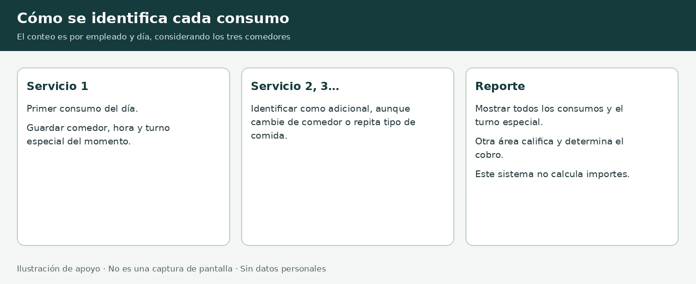

# Propuesta para presentar el avance

Sistema Integral de Comedores · AICM · Documento de trabajo para acordar con la jefatura

Corte: 21 de octubre de 2026. No es un compromiso de entrega aprobado ni una declaración de disponibilidad en producción. El objetivo es presentar evidencia y acordar qué debe entregarse al término del mes solicitado.

## 1. Mensaje de apertura sugerido

“Estamos desarrollando una aplicación web nueva para el control de comedores, tomando como referencia la operación del sistema actual. Ya contamos con una primera versión que compiló y fue probada en un entorno de desarrollo con empleados ficticios. Incluye acceso, registro de consumos e identificación de servicios adicionales, y un reporte por fechas, comedor y categoría. Estamos completando el arranque en el equipo local. Proponemos acordar un alcance de piloto para el mes solicitado, con revisiones semanales y criterios de aceptación.”

La fecha en que se pidió el proyecto y la fecha exacta de entrega deben confirmarse con la jefatura. No convertir “un mes” automáticamente en cuatro semanas ni inventar un vencimiento. Las semanas siguientes son una secuencia de trabajo que deberá ajustarse al calendario aprobado.

## 2. Evidencia disponible

| Elemento | Estado y evidencia |
| --- | --- |
| Conocimiento del proceso | Revisados formularios VB6, esquema SQL de 11 tablas, pantallas y reglas aclaradas con el responsable |
| Base tecnológica | ASP.NET Core 10, C#, Razor Pages, EF Core y PostgreSQL |
| Primera versión | Código guardado en GitHub, rama desarrollo/primera-version-web, commit inicial fc32bb6 |
| Compilación | Exitosa en nube, sin errores ni advertencias en la comprobación registrada |
| Reglas con PostgreSQL | 13 comprobaciones aprobadas: repetición, reenvío, concurrencia, conteo entre comedores, horarios y categorías, entre otras |
| Flujo HTTP | Prueba aprobada de acceso protegido, login, consulta, registro, reenvío y filtros |
| Equipo Windows | SDK 10.0.402, VSCodium, PostgreSQL/pgAdmin y base comedores; carpeta del proyecto abierta |
| Demostración en Windows | Pendiente de confirmar arranque, conexión, login y primer consumo |
| Producción | No desplegada; no se ha validado en la red institucional |

No presentar un porcentaje de avance: aún no existe un alcance total aprobado que permita medirlo. El número de pruebas no equivale a cobertura completa ni a aceptación por el usuario.

## 3. Qué mostrar en una reunión de 10 a 15 minutos

1. Problema y objetivo (2 minutos): modernizar el flujo de comedores en web, conservando reglas útiles y usando un stack de aplicación de código abierto.
2. Alcance comprobado (2 minutos): herramientas preparadas, código versionado y validaciones realizadas. Aclarar que se usan datos ficticios.
3. Demostración (5 minutos), únicamente después de comprobarla en Windows: entrar con demo, consultar 40001, registrar consumos, consultar 49001 y mostrar el reporte. Explicar que el sistema identifica adicionales y turno especial; otra área califica y determina cobros.
4. Pendientes y siguiente hito (3 minutos): RH, jornada laboral, extemporáneos, permisos y despliegue. Mostrar el plan y solicitar decisiones concretas.

Si aún no inicia en Windows, mostrar el repositorio, los documentos y la evidencia de pruebas de nube. Decir “arranque local pendiente”. No usar diagramas como prueba de una pantalla funcionando ni improvisar una demostración no ensayada.

## 4. Alcance recomendado para el mes: piloto controlado

Proponer un piloto con usuarios y comedor designados, separado del sistema en operación, con registro normal y reporte validados por el área usuaria. El tamaño y el uso de datos reales dependerán de accesos, autorizaciones y pruebas. Mantener disponible el sistema actual durante el piloto.

Entregables propuestos:

- Acceso con permisos de operador, consulta de empleados habilitados y registro normal por comedor.
- Horarios y consecutivo diario entre comedores, sin bloqueo por consumos previos, con identificación de adicionales y turno especial del momento.
- Reporte de fechas inclusivas, categorías y comedor/GLOBAL, con cantidades, horas y detalle, sin cálculo de importes.
- Catálogo de empleados mediante mecanismo acordado con RH; registro de actualizaciones y tratamiento de bajas.
- Entorno de pruebas, procedimiento de instalación, respaldo y restauración, guía de usuario y acta de resultados.

Acordar expresamente si la captura extemporánea es necesaria para aceptar el piloto. Si lo es, incorporar autorización, motivo y tratamiento del orden diario de los consumos antes de comprometer la fecha. No dejarla como exclusión implícita.

La migración íntegra del histórico, reportes adicionales, fotos y administración avanzada se priorizarán con la jefatura. Si alguna es obligatoria en la primera entrega, ajustar el plan en lugar de asumir que cabe sin impacto.

## 5. Secuencia propuesta de cuatro semanas

| Etapa | Trabajo principal | Evidencia al cierre |
| --- | --- | --- |
| Semana 1 | Confirmar alcance y fecha; terminar arranque Windows; validar flujo normal con responsables | Demostración repetible y lista de reglas/pendientes aceptada |
| Semana 2 | Definir integración con RH, estatus, jornada laboral e IP; implementar permisos mínimos y datos de prueba representativos | Casos de prueba de empleados, accesos y horarios aprobados por usuarios |
| Semana 3 | Validar reporte y adicionales; completar funciones obligatorias acordadas, incluidos extemporáneos si entran al piloto | Reporte comparado con resultados esperados y defectos priorizados |
| Semana 4 | Ensayar despliegue institucional, concurrencia, respaldo/restauración y capacitación; corregir incidencias | Acta de aceptación del piloto o lista concreta de bloqueos |

Esta es una estimación condicionada: todavía no se ha determinado la capacidad disponible del equipo ni la complejidad de RH y de la infraestructura. Validar primero esas dependencias. Si ya transcurrió parte del mes solicitado, redistribuir el tiempo restante con el alcance prioritario; no reiniciar el plazo unilateralmente.

## 6. Reparto sugerido entre tres personas

| Persona | Responsabilidad propuesta | Resultado que aporta |
| --- | --- | --- |
| Responsable del proyecto | Reglas del negocio, coordinación con RH/jefatura y aceptación del usuario | Decisiones registradas y alcance claro |
| Compañero 1 | Entorno, base de datos, instalación y respaldos | Arranque documentado y recuperación ensayada |
| Compañero 2 | Casos de prueba, validación de reporte y guía de operación | Evidencia de pruebas e incidencias reproducibles |

Ajustar el reparto a la experiencia y disponibilidad real. Revisar código y cambios entre compañeros. El apoyo de IA acelera elaboración y análisis, pero el equipo mantiene la responsabilidad de revisar, probar y autorizar el uso institucional.

## 7. Criterios propuestos de aceptación

- Un operador autorizado inicia y cierra sesión; un usuario no autorizado no accede a funciones protegidas.
- La IP del equipo identifica el comedor correcto en la red real, incluidos los proxies autorizados.
- Los horarios se validan con hora del servidor en Ciudad de México; la jornada individual se incorpora conforme a la regla que confirme RH.
- El primer consumo tiene consecutivo 1; los siguientes se identifican como adicionales entre todos los comedores. Turno especial queda registrado, sin cálculo de cobros.
- Reenviar una solicitud no duplica consumos y registros simultáneos mantienen el conteo correcto.
- Reporte individual y GLOBAL concilian con casos esperados, incluyen todas las horas y conservan adicionales al filtrar.
- El acceso a datos de RH, los permisos y el tratamiento de bajas están documentados y probados.
- Se realiza y recupera un respaldo en el entorno de pruebas; usuarios designados validan la guía.

Antes del piloto, convertir estos puntos en casos con resultado esperado y responsable de aprobación. No declarar cumplidos los que solo están propuestos.

## 8. Decisiones que solicitar a la jefatura

1. Fecha exacta y significado de entrega: demostración, piloto o sustitución en producción.
2. Módulos obligatorios y prioridad de extemporáneos, histórico, fotos y administración.
3. Responsable de RH para estatus y jornada; fuente de datos y permiso de acceso.
4. Responsable de infraestructura para servidor, dominio, HTTPS, red, proxy y respaldos.
5. Usuarios/comedor del piloto y persona que firmará la aceptación.
6. Alcance de “todo open source”: stack de aplicación, alojamiento y/o estaciones; licencia del código propio.

La propuesta usa herramientas de aplicación de código abierto. Los equipos actuales Windows y el servicio GitHub son propietarios: no presentar el entorno completo como íntegramente libre. Para servidor se propone Linux y PostgreSQL; si se exige plataforma de alojamiento libre, evaluar una alternativa como Forgejo sin cambiarla hasta acordarlo.

## 9. Cómo informar avance sin prometer de más

Actualizar cada semana una hoja con cuatro datos: resultado demostrado, evidencia, siguiente hito y bloqueo con responsable/fecha de atención. Evitar frases como “ya está terminado” si falta despliegue o validación de usuarios.

Ejemplo para esta semana:

“Primera versión implementada y probada en nube con datos ficticios. Repositorio y guía disponibles. Entorno Windows preparado; siguiente hito: completar la demostración local. Para sostener el plan de piloto requerimos confirmar alcance, fecha, datos de RH y servidor de pruebas.”

La inquietud por el plazo se atiende haciendo visible el alcance y las dependencias. No tenemos evidencia de que la solicitud del jefe haya cambiado; pedir una revisión de avance y confirmar el objetivo permite trabajar con una expectativa común.
