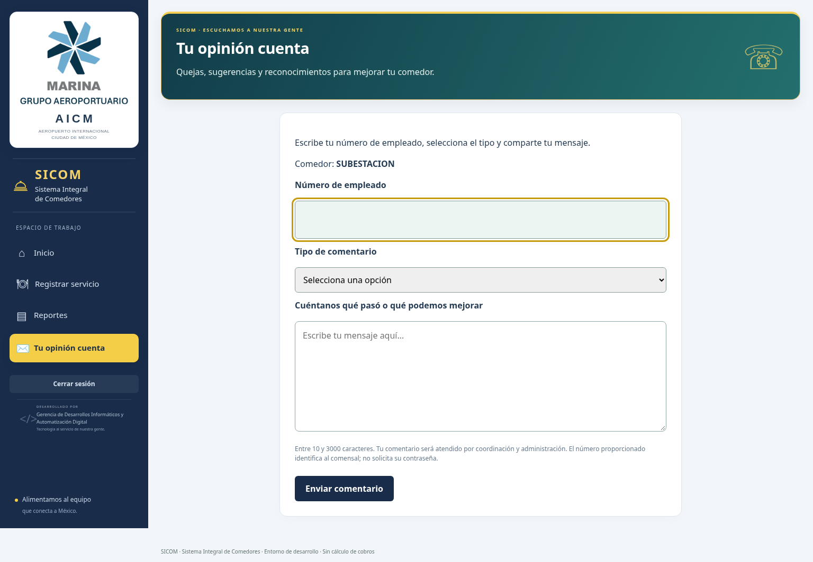
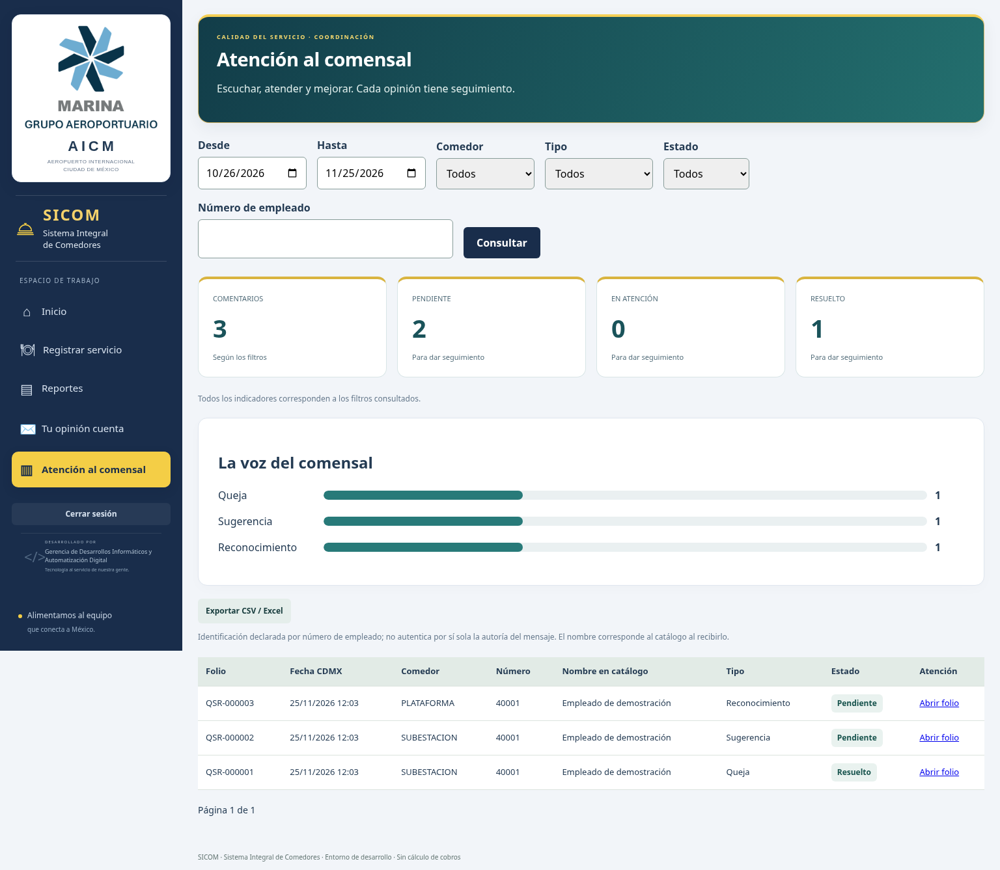
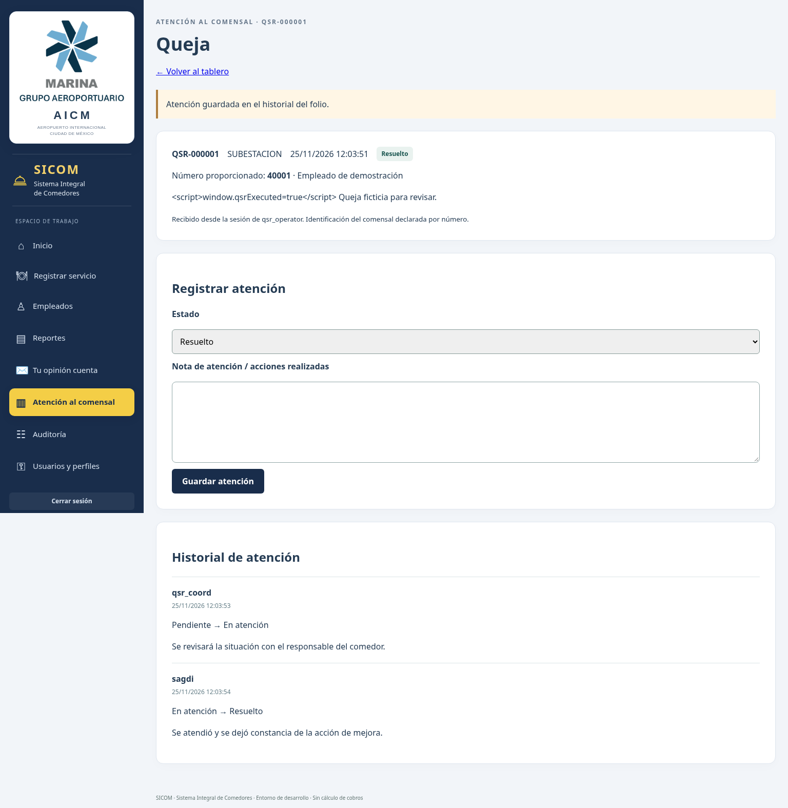

# Tu opinión cuenta — Quejas, sugerencias y reconocimientos

Módulo solicitado el 25/11/2026. Acceso confirmado por el usuario: **desde una sesión abierta por el operador**, sin pedir contraseña al comensal.

## Captura

En el menú, Inicio y la pantalla Registrar servicio aparece **Tu opinión cuenta** (`/Feedback`). El comensal captura:

1. Número de empleado, de uno a cinco dígitos, existente y activo.
2. Tipo, en un combo: **Queja**, **Sugerencia** o **Reconocimiento**.
3. Mensaje de 10 a 3000 caracteres.

Para Operador el comedor se obtiene de su terminal autorizada y asignación; no se puede cambiar mediante el formulario ni falsificando su parámetro. Coordinador y Administrador pueden recibir comentarios seleccionando el comedor, pues trabajan también desde equipos administrativos.

Al enviar, muestra un **folio QSR**, deja constancia de fecha real y sesión receptora y limpia los campos para el siguiente comensal. No muestra al operador una lista de comentarios ni los datos completos del empleado consultado. Si hay errores, conserva la captura para corregirla. El número identifica una cuenta del catálogo; por sí solo **no autentica la autoría** de quien redactó el mensaje.

La recepción no depende del horario de desayuno/comida/cena, no requiere registrar un consumo y no incrementa el contador de servicios. Usa hora real del servidor, incluso si la comida se está probando con fecha simulada. Cada nuevo formulario admite otro comentario; los reintentos del mismo envío conservan el folio y no duplican filas.

## Tablero y reportes

**Atención al comensal** (`/FeedbackBoard`) sólo permite acceso a **Coordinador y Administrador**, tanto por menú como por URL, detalle y CSV. Operador y Catálogo no pueden consultar ni modificar estos reportes; Catálogo sin otra función tampoco puede recibir comentarios.

Incluye:

- Filtros de fechas, comedor, tipo, estado y número de empleado.
- Total y cantidades por **Pendiente**, **En atención** y **Resuelto**.
- Gráfica por tipo de comentario.
- Tabla con folio, fecha CDMX, comedor, número, nombre del catálogo al recibir, tipo y estado.
- Paginación de 50 filas y exportación CSV/Excel de hasta 10 000 comentarios, respetando filtros. Periodo máximo de 366 días de diferencia entre fechas.

Los indicadores representan los filtros consultados. Se actualizan al consultar o recargar; no se agrega recarga automática que interrumpa una nota en edición. El CSV contiene el comentario original y estado actual; el historial completo se consulta dentro del folio.

## Atención e historial

En **Abrir folio** (`/FeedbackDetail?id=...`) el coordinador o administrador ve el mensaje original, registra estado y una nota de atención de 5 a 3000 caracteres. Puede añadir varias notas o reabrir un folio, dejando constancia del cambio.

Cada nota conserva usuario, IP, fecha real y transición de estado. No hay botones de eliminación ni edición del mensaje original o de notas previas. Una pantalla desactualizada no sobrescribe la atención de otra persona: muestra un aviso, actualiza el historial y conserva la nota que estaba redactándose para revisión antes de guardar de nuevo.

La auditoría registra recepción y atención, con folio y datos de contexto, sin duplicar el contenido completo del mensaje o nota en `AuditLogs`. Los textos completos sólo están en las tablas del módulo y sus exportaciones autorizadas.

## Datos y despliegue

Tablas nuevas: **FeedbackEntries** y **FeedbackFollowUps**, con índices, folio interno, identificador único de solicitud y relaciones con empleado/comedor. Su creación es **aditiva durante el arranque**; no se vacían ni sustituyen las tablas existentes.

La recepción, la atención y sus eventos de auditoría utilizan transacciones. Las solicitudes repetidas son idempotentes; el seguimiento utiliza versión y bloqueo para evitar actualizaciones simultáneas perdidas. Se conserva la protección antifalsificación de formularios, validación de servidor, respuestas privadas sin caché, salida HTML como texto y neutralización de fórmulas en CSV.

No utiliza correo, adjuntos ni notificaciones externas. No ofrece consulta pública de folios. El seguimiento se realiza dentro del tablero por los perfiles autorizados.

Las claves foráneas preservan el historial de comentarios. La herramienta excepcional que reemplaza físicamente todo el catálogo de empleados puede quedar bloqueada si ya hay comentarios relacionados; no eliminar comentarios ni usar `CASCADE` para forzar esa operación. Las altas/modificaciones/bajas habituales de empleados siguen funcionando. Limpiar consumos y recogidas no borra comentarios.

## Integración local y producción

Primero respaldar y verificar la copia local `comedores_pruebas`. Integrar juntos `FeedbackService.cs`, `Data.cs`, las tres páginas y modelos, enlaces, CSS, JS y ajustes de `Program.cs`. Conservar los parámetros particulares de `iniciar-windows.ps1`, configuración privada, cuentas `sagdi`, IP reales de los comedores y `ForwardedHeaders` de la publicación. Este cambio no modifica el script de inicio ni el mapa de terminales.

Al iniciar localmente se crean las dos tablas si faltan. Probar con datos ficticios sólo en esa base y verificar con cada perfil.

Para **172.16.2.12**, continuar paso a paso con el usuario: paquete Linux desde copia temporal, hashes, respaldo actualizado de código/configuración/fotos/base y restauración de prueba, pausa breve, instalación preservando `appsettings.Production.json`, arranque y verificación de permisos y tablas. No copiar la base local sobre producción. La cuenta de base de datos necesita los permisos de creación de tablas que ya utiliza para las actualizaciones aditivas.

En producción verificar que las páginas abren y el tablero sólo es accesible para los perfiles correctos; no registrar quejas ficticias como prueba. No borrar registros reales ni reemplazar el catálogo. Si se revierte sólo el código, conservar las tablas nuevas para no perder comentarios recibidos.

**Este desarrollo no se ha instalado aún en Windows ni en el servidor del usuario.**

## Verificación

- Compilación sin errores ni advertencias.
- **139 comprobaciones** de lógica en bases temporales, incluidas validación, comedor protegido, fecha real, reenvío simultáneo, control de versión, historial, filtros, CSV y auditoría sin copia del mensaje sensible.
- `tests/browser/feedback.cjs` crea y elimina su propia base e instancia. Verifica sesiones, CSRF, rechazo de empleados inexistentes/inactivos, privacidad del formulario, tipos, texto, doble envío, controles para todos los perfiles, mensaje HTML sin ejecución, atención concurrente con borrador conservado, filtros/gráfica, CSV, reinicio y cuatro tamaños de pantalla.

Las capturas siguientes utilizan datos ficticios.

